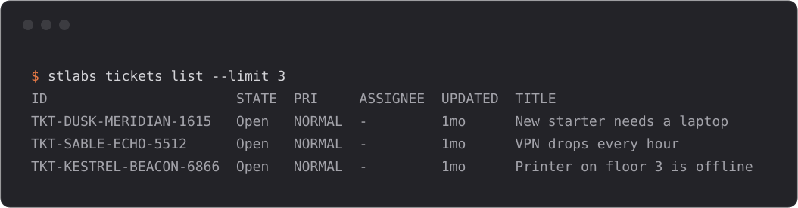

<p align="center"><picture><source media="(prefers-color-scheme: dark)" srcset="assets/wordmark-dark.svg"></picture></p>

<p align="center">STLabs in your terminal.</p>

<p align="center"><a href="https://github.com/Standard-Template-Labs/cli/releases/tag/v0.2.0"></a> <a href="https://github.com/Standard-Template-Labs/cli/releases"></a> <a href="https://stlabs.com/terms"></a></p>

<p align="center"></p>

## About

stlabs is the command line for Standard Template Labs (STLabs).

- Read, search, create and update tickets without leaving the shell.
- Script it: JSON out, exit codes, safe retries with an idempotency key.
- One folder per platform, no runtime to install.
- Built from the same API description as the service, so it never drifts.

## Installation

stlabs is available for macOS (Apple silicon) and Linux (x86_64).

```sh
curl -fsSL https://github.com/Standard-Template-Labs/cli/releases/latest/download/install.sh | sh
```

The script fetches this platform's build, checks it against the release's checksums, and by default unpacks it under `~/.local/share/stlabs` and links `~/.local/bin/stlabs`. It edits no shell files; if `~/.local/bin` is not on your PATH, it prints the line to add. To install a release candidate, name its version: end the command with `sh -s -- --version <version>`.

Check the install with `stlabs --version`.

macOS may block the first run of an unsigned app. If it does, open System Settings, Privacy & Security, and choose Open Anyway.

<details>
<summary>Manual install</summary>

### macOS

```sh
curl -fsSL -o stlabs.tar.gz https://github.com/Standard-Template-Labs/cli/releases/download/v0.2.0/stlabs-0.2.0-darwin-arm64.tar.gz
mkdir -p ~/.local/share/stlabs/versions/0.2.0 && tar -xzf stlabs.tar.gz --strip-components=1 -C ~/.local/share/stlabs/versions/0.2.0
mkdir -p ~/.local/bin && ln -sfn ~/.local/share/stlabs/versions/0.2.0/stlabs ~/.local/bin/stlabs
```

### Linux

```sh
curl -fsSL -o stlabs.tar.gz https://github.com/Standard-Template-Labs/cli/releases/download/v0.2.0/stlabs-0.2.0-linux-x86_64.tar.gz
mkdir -p ~/.local/share/stlabs/versions/0.2.0 && tar -xzf stlabs.tar.gz --strip-components=1 -C ~/.local/share/stlabs/versions/0.2.0
mkdir -p ~/.local/bin && ln -sfn ~/.local/share/stlabs/versions/0.2.0/stlabs ~/.local/bin/stlabs
```

</details>

### Update and uninstall

Update: run the install line again. It installs the newest release and keeps the one before it. If you installed the agent skill, run `stlabs setup` again to update it.

Uninstall: run `stlabs logout`, then remove `~/.local/share/stlabs`, `~/.local/bin/stlabs` (the default locations) and `~/.config/stlabs`. If you installed the agent skill, also remove its `stlabs-cli` folder wherever it is installed, such as in `~/.claude/skills` or `~/.agents/skills`.

## Usage

**List and read.** On a terminal a list is a table; everything else is JSON.

```sh
stlabs tickets list --limit 3                            # the newest tickets, as a table on a terminal
stlabs tickets get TKT-DUSK-MERIDIAN-1615                # one ticket, as a person reads it
stlabs tickets get TKT-DUSK-MERIDIAN-1615 --output json  # the same ticket, as JSON
```

```
ID                       STATE  PRI     ASSIGNEE  UPDATED  TITLE
TKT-DUSK-MERIDIAN-1615   Open   NORMAL  -         1mo      New starter needs a laptop
TKT-SABLE-ECHO-5512      Open   NORMAL  -         1mo      VPN drops every hour
TKT-KESTREL-BEACON-6866  Open   NORMAL  -         1mo      Printer on floor 3 is offline
```

```
New starter needs a laptop
● TKT-DUSK-MERIDIAN-1615  Open · NORMAL · - · 1mo
  Reported from the terminal.
  Requester     Dana Okafor
  You can       move it to In progress, On hold, Resolved, Closed, Canceled; change title,
                description, priority, assignee, queue, followers
```

<details>
<summary>Example output of <code>tickets get --output json</code></summary>

```json
{
  "assignee": null,
  "available_actions": {
    "editable_fields": [
      "title",
      "description",
      "priority",
      "assignee",
      "queue",
      "followers"
    ],
    "transitions": [
      "in_progress",
      "on_hold",
      "resolved",
      "closed",
      "canceled"
    ]
  },
  "created_at": "2026-09-14T09:00:38Z",
  "description": "Reported from the terminal.",
  "followers": [],
  "hold": null,
  "id": "TKT-DUSK-MERIDIAN-1615",
  "priority": "normal",
  "queue": "2c076030-eb94-51a1-8325-40b0c777ad23",
  "requester": {
    "display_name": "Dana Okafor",
    "id": "6a1f0c1e-3b1d-5c8e-9f0a-000000000001"
  },
  "routing": "settled",
  "service_level": {
    "breach_count": 0,
    "resolution_due_at": null,
    "resolution_paused": false,
    "response_due_at": null
  },
  "state": "open",
  "synced_from": null,
  "title": "New starter needs a laptop",
  "updated_at": "2026-09-14T09:00:38Z",
  "web_url": null
}
```

</details>

**Create and update.** Fields go in one argument of `name: value` pairs.

```sh
stlabs tickets create --title 'Printer on floor 3 is offline' --requester-email dana@northwind.example  # file a ticket
stlabs tickets update TKT-DUSK-MERIDIAN-1615 --priority urgent                                          # change its fields
stlabs tickets comments create TKT-DUSK-MERIDIAN-1615 --body 'Replaced the toner.'                      # add a comment
```

**Script it.** Piped or redirected output is JSON, one record per command, so pipe it into jq or capture it. A command that fails exits with a code that says why.

```sh
stlabs tickets get TKT-DUSK-MERIDIAN-1615 | jq -r .state  # piped output is JSON
```

## Agent skill

stlabs includes a skill that lets Claude Code and other coding agents work with your tickets through the command line. Run `stlabs setup` once. At a terminal it offers to sign you in, uses the organization you're signed into on the web, and asks for it when it can't tell, for example after `--device` sign-in, then installs the skill for the agents on this machine. `stlabs org set <slug>` changes the organization. With `-y` or no terminal it asks nothing, installs the skill and lists what is left. `stlabs setup --status` shows where you stand and whether the skill is current. An agent can run `stlabs agent schema` to read the commands of the stlabs installed here. To use the skill with another agent, copy the two files in [skills/stlabs-cli](skills/stlabs-cli) into that agent's skills folder.

## Documentation

- [Documentation](https://standard-template-labs.github.io/cli/): the command line guide and the API reference.
- [Releases](https://github.com/Standard-Template-Labs/cli/releases): every build, with checksums and notices.

## Questions and support

Questions, access requests and problems: support@stlabs.com.

Security issues: security@stlabs.com, see https://stlabs.com/security.

## License

The stlabs binary is Standard Template Labs (STLabs) software, under the terms at https://stlabs.com/terms. The open source software bundled in it is listed, with its licenses, in THIRD_PARTY_NOTICES.md on each release.
